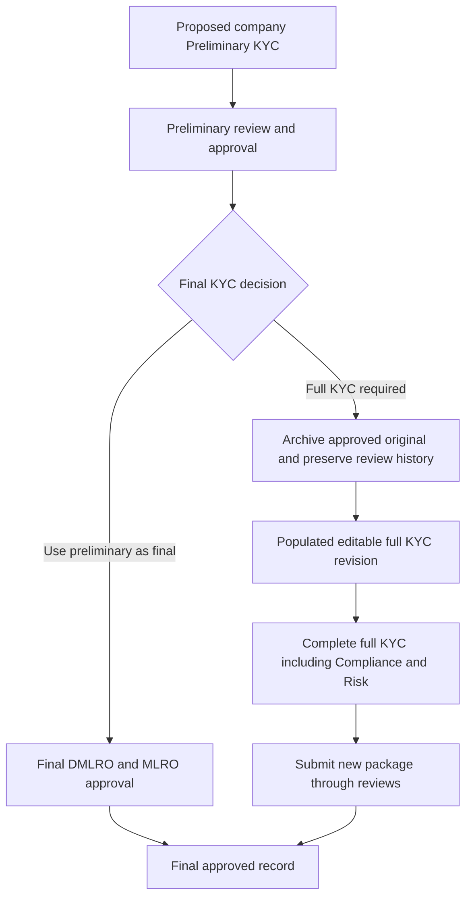

# Newoon MIS System Architecture Review

## Purpose and conclusion

This document explains how Newoon MIS takes an enquiry through KYC preparation, screening, risk assessment, internal review and client activation. It gives management an architecture evaluation to approve before handing the system to independent QA.

**Recommendation: proceed to controlled staging evaluation, not an unconditional production rollout.** The source implements the principal journeys and recent corrections, but the review identifies unresolved authorization, post-submission editing, history-retention and transaction risks. Local checks are not proof that deployed behavior is correct. Refer to the findings register for evidence and recommended decisions.

Baseline: commit `7da1a27`, reviewed 27 October 2026. Coverage: 118 registered HTTP operations and 30 frontend routes. This is a source review; the server version, production configuration, database constraints in use and backup recoverability have not been verified.

## What management is evaluating

Every workflow needs a defined entry, permitted user, required information, business validation, controlled status transition and accountable next owner. Its exits must include rejection, return and failure, not just success. Every API must enforce the same rules as the screen: hiding a button is not authorization.

The accompanying technical appendix identifies the implemented interfaces. The workflow specification explains their business logic. The QA checklist turns those rules into reproducible tests. This pack does not silently repair defects or replace business-owner approval of exceptional approval routes.

## System architecture

```mermaid
flowchart TB
  User[Authenticated staff browser] --> UI[React and Vite frontend]
  UI -->|HTTPS JSON and multipart| Edge[Reverse proxy and TLS boundary]
  Edge --> API[NestJS API under /api]
  API --> Auth[JWT current user validation and role area controls]
  Auth --> Services[Enquiry KYC Screening CRRF and admin services]
  Services --> Prisma[Prisma Client]
  Prisma --> DB[(PostgreSQL tenant data and history)]
  Services --> Storage[(Private upload directories)]
  Services --> Export[Shared KYC document model]
  Export --> Word[DOCX generator]
  Export --> Chrome[Headless Chromium PDF renderer]
  Services --> History[Status history audit records and notifications]
  History --> DB
```

The application is an npm workspace monorepo. The frontend presents role-specific workspaces; Nest services implement the business decisions. PostgreSQL holds structured records, JSON form sections, review versions and generated document bytes. Uploaded source files also depend on persistent filesystem storage. Database backup alone is therefore insufficient. The proxy/TLS boundary is a deployment assumption, not verified infrastructure inventory.

The backend serves the built frontend when present. JWT validation reloads the current user and roles. A configurable access matrix can override controller role lists, while some services also enforce specific role/stage restrictions. This layered model requires testing in both configured and fallback modes; its implementation has a cross-tenant administration concern in F-01.

## Main customer journey

```mermaid
flowchart LR
  BD[Operations creates enquiry] --> AML[AML checks intake]
  AML -->|Needs correction| Return[Return to Operations]
  Return --> BD
  AML --> Prep[Convert to KYC and prepare package]
  Prep --> Evidence[Screening and CRRF evidence]
  Evidence --> Supervisor[Supervisor submits package]
  Supervisor --> DMLRO[DMLRO review]
  DMLRO -->|Return with reason| Prep
  DMLRO --> MLRO[MLRO decision]
  MLRO -->|Return| DMLRO
  MLRO -->|High risk or escalation| SEF[SEF management decision]
  SEF -->|Return| MLRO
  MLRO --> Final[Approved KYC finalization]
  SEF --> Final
  Final --> Engagement[Signed engagement and Operations decision]
  Engagement --> Active[Client active or on hold or rejected]
```

This diagram shows the principal route, not all exceptional routes. The implementation also contains DMLRO final approval during MLRO absence, conditional approvals and a second review of Preliminary KYC selected as final. These require explicit policy approval, especially who may invoke exceptions and what evidence proves absence or delegation.

## Preliminary KYC and full KYC

Preliminary KYC omits full-KYC Compliance and Risk questions. Full KYC requires explicit PEP, sanction and dual-citizenship responses before Supervisor submission. The current conversion creates a populated revision, retains comments and completed tasks, resets active approval decisions and opens AML preparation. Historical approvals do not constitute approval of the new full form.

The original is inspectable through Form history and compare. Available attachments are copied into revision storage; already missing source files cannot be recovered. This is application history, not tamper-proof archival storage, and cascade deletion remains a serious retention concern (F-06).

## Roles and accountability

| Role | Principal responsibility | Boundary to verify |
|---|---|---|
| Operations or BD | Enquiry intake, requested services, documents, signed engagement decision | Cannot change submitted review content or approve its own compliance review |
| AML Team and Supervisor | Prepare KYC, Screening, CRRF, submit review package, respond to returns | Preparation locked during downstream review; full draft reopened only deliberately |
| DMLRO | Review package, return or forward to MLRO; final decision capability | Can edit own active stage only; exception approval requires approved policy |
| MLRO | Final risk/decision, return or route to SEF; final decision capability | High-risk route and prior-stage checks must be enforced server-side |
| SEF | Management decision for escalated/high-risk files | Return to MLRO or conclude authorized management review |
| Company Admin | Tenant administration and existing workflow overrides | Must not acquire cross-tenant/global privileges through area grants |
| Super Admin | Platform access and global configuration | Exceptional access must be audited and operationally controlled |
| Accounting and HR | Limited views according to access configuration | No implied KYC decision privilege; test direct API calls |

Actual grants depend on the configured matrix and service checks, not this responsibility summary alone. Shared comments and confidential notes have different audiences. F-09 asks management to confirm SEF visibility for scopes labelled MLRO only.

## Controls and evaluation outcome

Implemented controls include current-user JWT validation, many tenant-scoped reads, stage-specific form checks, revision tokens, review snapshots, explicit Screening/CRRF prerequisites, protected upload paths and shared export logic. Their existence is verified in source; comprehensive runtime effectiveness is not yet established.

The highest-priority findings are: area grants replacing stricter role decorators on global administration APIs; tenant details returning full user rows; Screening/CRRF evidence remaining mutable after handoff; and deletion paths capable of removing retained history. Other risks include partial autosaves, non-atomic activation and GET initialization writes. See F-01 through F-09 for reproducible checks, limitations and proposals.

## Required decisions before release

Management must approve exceptional approval authority, separation of duties, confidentiality audiences, retention/deletion policy and whether submitted evidence must be frozen. Engineering must close or explicitly disposition the findings; a risk acceptance does not replace a demonstrable security control. QA then tests the agreed rules against the exact deployed staging commit.

The release requires passing role/tenant negative tests, end-to-end standard and Preliminary KYC journeys, full-KYC continuation, repeated returns, document fidelity and preservation tests. Operations must demonstrate restoring both database and uploads and provide a safe migration/rollback record. No production recommendation is issued until those gates have evidence and named owners.
