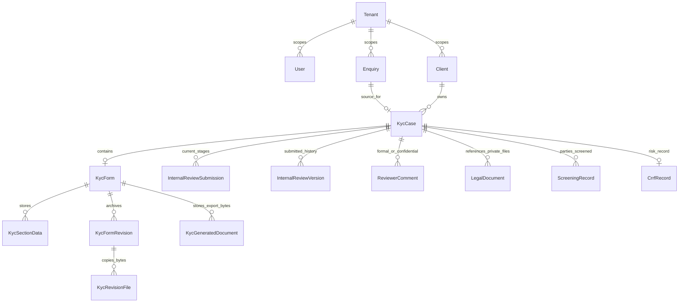
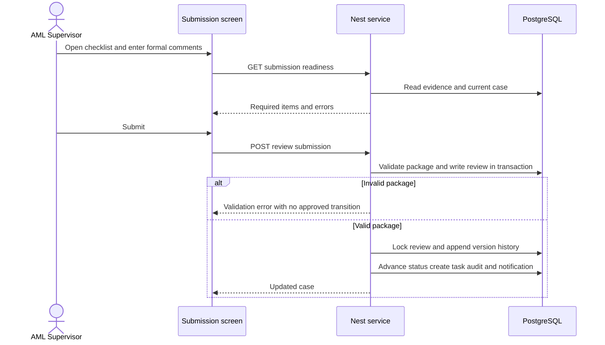

# Workflow and Business Logic Specification

Baseline and evidence definitions are in [README](README.md). This specification describes observed source behavior and clearly marked acceptance expectations. It is not a claim all rules are implemented consistently. Endpoint IDs resolve in the technical appendix; all remaining administration/list/file operations are included there and in the endpoint matrix.

## Common rules

| Rule | Expected invariant | Evidence or qualification |
|---|---|---|
| R-01 | JWT required except login and health; inactive sessions rejected | AuthController, JwtStrategy; strategy checks SUSPENDED, not all non-ACTIVE values |
| R-02 | Tenant resource ownership checked before reading or changing it | Service tenant filters; global administration risk F-01 |
| R-03 | Business action needs role/area AND valid state; UI alone never grants authority | RolesGuard matrix precedence and service guards differ; F-01/F-03 |
| R-04 | Draft saves may be incomplete; submission validates readiness | Enquiries assertCompletePreliminaryKyc; Kyc assertReviewPackageReady |
| R-05 | Direct shareholders total 100 at Preliminary submission; linked UBO percent is separate | Preliminary validator; full KYC per-layer upper bound does not establish exact completeness |
| R-06 | Supervisor submission needs Screening, CRRF file/risk and nonempty formal comments | Legacy submit-to-aml and Supervisor submit path; compare both |
| R-07 | Full KYC has explicit Compliance and Risk answers; Preliminary KYC excludes them | common/kyc-compliance.ts and export model |
| R-08 | Only current review stage edits its decision; return explicitly reopens | Kyc saveInternalReview/saveReviewDraft; evidence editing gap F-03 |
| R-09 | New full/amended form preserves archived original and review history | beginFormAmendment; retention caveat F-06 |
| R-10 | Stale version cannot overwrite a newer form; rejected save must not partially persist | expectedVersion implemented; composite atomicity gap F-04 |
| R-11 | High-risk MLRO approval goes to SEF; exceptional bypass needs approved policy | HIGH check uses submitted finalRiskClassification; B-01/F-09 |
| R-12 | Client activation follows final approval and signed engagement | completeEngagementDecision; atomicity/checklist issue F-05 |
| R-13 | Formal feedback is shared with authorized case viewers; confidential data remains restricted | sharedReviewFeedback, confidentialCommentWhere; B-04/F-09 |
| R-14 | Export content reflects saved data and correct revision, with protected files | export model, stored generated documents; live preview is separate implementation |
| R-15 | Critical changes leave actor/time/history; failures do not report false success | Audit/history use is uneven; test endpoint side effects individually |

## Workflow records

### Data ownership and preservation map

This is a selected conceptual relationship diagram, not a replacement for schema cardinalities and delete rules in the appendix. AuditLog and status histories track actors/events separately; Notification routes work to users. Live legal/Screening/CRRF documents rely on external storage; archived KycRevisionFile/generated exports contain copied bytes in PostgreSQL. No diagram arrow implies legal retention protection or an immutable database constraint.

### Submission sequence and failure boundary

This describes the intended transactional handoff, not a guarantee of race safety. State checks can happen before transactions and file storage is outside them; Q-RACE and failure injection must validate the actual boundary. Composite draft autosave is a separate sequence of section writes (F-04), not this single review-submit transaction.

### WF-01 Authentication and session

Entry: login screen or API-4B243C69. Actor: unauthenticated user. Inputs: LoginDto email/password. Rules: lowercase email lookup, bcrypt comparison, SUSPENDED rejected; successful login records LOGIN audit and issues JWT with public user/access metadata. Exit: authenticated session or 401. Every protected call re-queries current user/roles (API-56B94144 for public profile). Logout in browser is not a token-revocation endpoint. Next owner: user. QA: Q-01, Q-02. R-01/R-02.

### WF-02 Access configuration and administration

Entry: administration pages; API-877BF8E4, API-8B7FA898 and tenant/user/module endpoints. Actors: controller role defaults and configured matrix; Super Admin is fixed full access. Inputs: role name and levels NONE/VIEW/EDIT across seven areas; tenant DTO; module assignment payload. Saves: RolePermission catalog/configuration and TenantModule associations. Exit: updated matrix or validation error; next owner: platform/tenant administrator. Matrix/catalog reads can initialize catalog records. Global role grants are not tenant-specific. Do not infer a user-create or password-reset API: current UsersController exposes listing. Audit/notifications are not universal across admin services. F-01/F-02, B-02. QA Q-03 through Q-06.

### WF-03 Enquiry entry and correction

Entry: `/enquiries/new`, existing enquiry edit, API-2A03FCD2/API-AA5ECB01. Actors: Operations with administrative/AML editing rules. Inputs: existing legal entity, proposed company, or current client/new services; requested service(s); company/contact, proposed owners/managers/declaration and attachments as applicable. Contact UI requires Name, Mobile Number and Position; optional email/identity/nationality remain optional. Transport DTO and server Preliminary completeness differ from UI completeness: direct API negative tests are mandatory.

Draft writes Enquiry/details and associated records. API-F4305601 submits DRAFT or RETURNED_TO_BD to SUBMITTED_TO_AML_SUPERVISOR, creates EnquiryStatusHistory and AML notifications. AML can return to BD or mark READY_FOR_KYC. State change and history occur inside a transaction; errors inside it should roll back. Not every enum target has a complete source-state/role transition guard (F-09). Next owner: AML, or Operations on return. Editing linked enquiries is blocked during downstream KYC review for non-admins. Terminal alternative: deletion, subject to retention policy. QA Q-07 through Q-10. R-03/R-04/R-15.

### WF-04 Preliminary KYC

Entry: proposed-company enquiry, `/api/enquiries/:id/preliminary-kyc` save/complete/PDF operations. Actor: Operations/AML according to decorators and service enquiry-edit checks. Inputs: company/legal form/jurisdiction/address/business/source of funds, shareholders, natural-person UBOs, management, documents, contact and declaration. Submission verifies company fields, shareholder totals, management and at least one document availability flag. It does not prove uploaded bytes exist merely because a checklist says available. Drafts can remain incomplete. Server required-address policy differs from frontend legal-form exception (B-05).

Data: Preliminary JSON in Enquiry.details, attachment records/files. Completion/submission proceeds toward AML intake and READY_FOR_KYC. PDF downloads authorized saved data directly, without browser print headers. It does not contain full-KYC Section D. Next owner: AML Supervisor. Return: keep data, correct and resubmit. QA Q-08/Q-09/Q-11/Q-23. R-04/R-05/R-07.

### WF-05 Conversion and alternate direct case entry

Entry: API-AAC19E27 after READY_FOR_KYC, or direct client/case create API-BABA0CF1/API-F3EDD356. Conversion checks tenant/client and uses a source-enquiry unique relationship and transactional status claim to avoid duplicate conversion. It creates or resumes a case, initial form/sections and review-related records as implemented; owner-facing enquiry becomes CONVERTED_TO_KYC. Proposed-company source document and declaration/signature/stamp are carried into the KYC presentation. A direct client create sets ACTIVE without this journey (B-03).

Case initial status is INQUIRY_RECEIVED or LEGAL_DOCUMENTS_PENDING, with uploaded-document status depending on conversion data. History and notifications must be checked per branch rather than assumed for every create. Next owner: AML preparation. Failure: invalid READY state or wrong tenant rejected; race should not create two cases. QA Q-12/Q-13. R-02/R-09.

### WF-06 KYC preparation and attachments

Entry: `/kyc/:id/form`, API-0AED223E/API-BC473411, section A-H PATCH and API-A3C714C0. Actor: AML preparation roles, admins; later reviewers get only their section. Preparation states are INQUIRY_RECEIVED, PROPOSAL_OPTIONAL, LEGAL_DOCUMENTS_PENDING, LEGAL_DOCUMENTS_UPLOADED, SUPERVISOR_REVIEW_PENDING, SUPERVISOR_ADDITIONAL_INFORMATION_REQUIRED. Legacy AML_REVIEW_STARTED is editable only for an unlocked fullKycStarted AMENDMENT_DRAFT.

Inputs: A company, B ownership/control, C officers, D risk/compliance, E contact, F documents, G declaration; H internal review. Version is sent as expectedVersion on sections and version on autosave. Saves write KycSectionData and normalized party/document/review models. B prevents percentages above 100 within a layer and validates corporate-parent links; direct totals shown in downloads are calculated from root shareholders. UBO ownership must not be added to direct shareholder total.

Section D draft questions are explicitly Yes/No, with details for Yes required at Supervisor submission. Document upload endpoints validate type/size and path containment; metadata-only and file-backed upload routes both exist. Save failures show an error; composite autosave is sequential, not one transaction (F-04). Next owner: Supervisor/package preparation. QA Q-14 through Q-17/Q-24/Q-28. R-05/R-07/R-10.

### WF-07 Screening

Entry: `/kyc/:id/screening` and context/records/common-check/evidence endpoints. Actor: AML/edit grants; reviewers have view defaults. Inputs: client/shareholder/UBO/manager/manual entity identity, country, individual conclusions, tool selections/results/notes and common evidence. Current source returns mandatory/result-required tool lists through context, including NCTC/UN/OFAC/EU/PPO/World-Check/Google as applicable; OTHER is an individual option rather than an interchangeable common check.

Writes: ScreeningRecord, ScreeningCheck, ScreeningCaseCheck, ScreeningDocument and ScreeningCaseDocument plus filesystem evidence. A completed record needs its required results/conclusion; common evidence and every current-party match are checked again before Supervisor submission. Potential/confirmed findings require notes. Context GET initializes missing check records. Dropdown removal of already screened entities is presentation behavior, not submission completeness proof. Post-handoff writes are not stage-locked here (F-03). Next owner: AML completes package. QA Q-18/Q-19/Q-25. R-06/R-08.

### WF-08 CRRF

Entry: `/kyc/:id/crrf`, API-081C6E9B/API-5458803A plus upload/export routes. Actor: AML/DMLRO/MLRO edit defaults; SEF view. Inputs: LOW/MEDIUM/HIGH, optional internal comment, PDF/XLS/XLSX support within upload constraints. Save requires risk rating and at least one uploaded supporting document. Upload creates documents separately from Save Draft; frontend should update immediately and preserve unsaved fields.

Writes: CrrfRecord/Documents and private storage. Workspace GET ensures record existence; reports exclude internal comments. Excel export is HTML with an Excel MIME/extension rather than a native XLSX workbook. Delete removes file before database row. Stage locking/file atomicity concerns: F-03/F-07. Next owner: Supervisor submission. QA Q-20/Q-25/Q-26. R-06/R-08/R-14.

### WF-09 Supervisor package submission

Entry: submission page/readiness API-86FF54AD and API-D128107A, or API-C8B81FCD. Actor: Supervisor/AML according to service/decorators. Prerequisites: writable preparation stage, Screening complete for current parties/common evidence, CRRF risk plus file, full-KYC compliance when applicable, nonempty sanitized formal comment. The legacy path also checks preparation upload count. Readiness UI is advisory; backend rechecks.

Success locks/snapshots Supervisor submission, completes appropriate task, creates DMLRO task, records status/history/audit and notification. Exit: DMLRO_REVIEW_PENDING (legacy submitted statuses also exist in schema). Missing requirements must not advance status or create approval. Next owner: DMLRO. QA Q-21/Q-22/Q-29. R-06/R-07/R-08.

### WF-10 DMLRO review and return

Entry: review task/form/internal-review workspace; start/draft, API-C65454C8. Actor: DMLRO or existing admin override. Requires active task and unlocked submission; draft section H checks active case stage. Inputs: decision, comments/reason/conditions, reviewer/date/signature through UI. APPROVE/APPROVE_WITH_CONDITIONS locks review and routes to MLRO_REVIEW_PENDING. RETURN_TO_SUPERVISOR/REQUEST_ADDITIONAL_INFORMATION snapshots current form, advances revision, reopens preparation and notifies AML. Original comments are available through submitted versions/shared feedback.

Exception DMLRO_FINAL_APPROVE records MLRO_APPROVED directly with audit reason; code does not prove MLRO absence. This is B-01, not automatically accepted policy. The API path and UI validation are different contracts; QA must attempt malformed direct submissions. QA Q-22/Q-27/Q-29/Q-30. R-08/R-09/R-11/R-13.

### WF-11 MLRO and SEF decisions

Entry: API-3D4B2E9E/API-B3555C2D, stage tasks and section H. MLRO requires active task and locked prior DMLRO submission; despite bypass-related code, assertPreviousStageComplete is still called first. MLRO decisions: approve, conditional approve, reject, request information, return to DMLRO, send to SEF. Non-simple approvals need reason/conditions; supplied risk changes need explanation. Submitted HIGH finalRiskClassification cannot approve without SEF. Confirm persisted risk cannot bypass this by omission (F-09).

MLRO return reopens DMLRO task/submission. SEND_TO_SEF creates SEF pending task and notification. SEF approve/conditional/reject/return routes by implemented decision, with return reopening MLRO. Submitted decisions create immutable review versions, status history, audit and notifications. Next owner: prior reviewer on return; otherwise final decision owner/Operations. Confidential scopes are not equivalent to formal feedback. QA Q-27/Q-29/Q-31/Q-32. R-08/R-11/R-13.

### WF-12 Final KYC and full completion

Entry: API-B62F552C after MLRO_APPROVED, MLRO_APPROVED_WITH_CONDITIONS or SEF_APPROVED. Actor: AML Supervisor/DMLRO/MLRO with existing admin and applicable SEF/AML Team preliminary behavior. SAME_KYC_FINAL on Preliminary KYC routes for final DMLRO/MLRO approval rather than immediate activation; the form gets PRELIMINARY_FINAL_REVIEW and is finally locked on approval. Standard approved KYC can be marked FINAL/KYC_FINAL_APPROVED.

AMENDMENT_REQUIRED for a Preliminary case calls full conversion: archive form and available files, keep original Preliminary JSON/declaration and comments/review versions, open fullKycStarted AMENDMENT_DRAFT and SUPERVISOR_REVIEW_PENDING with Supervisor task. Completed tasks are retained on this path. Existing matching legacy full drafts remain editable. Full KYC completes A-G including Section D and resubmits normally. Prior signature/decision fields are reset for new approval; archived signatures remain original evidence, not reapproval.

Data/history retention is subject to F-06; no claim of WORM/legal archive is made. Next owner: AML for full completion, or Operations after final approval. QA Q-23/Q-30/Q-33. R-07/R-09/R-12.

### WF-13 Amendments and comparison

Entry: API-AF4E1C0A after approval, or reviewer return. Inputs: sections and reason for explicit amendment. Writes: KycFormRevision unique(form,version), independently copied available KycRevisionFile bytes, incremented version, reopened active review state and inactive prior signed uploads. Form history supports old/current and old/old comparisons, archived downloads and attachments. Current section H is not proof of earlier approvals: use submitted versions/archive.

Generic startAmendment routes AML_REVIEW_STARTED and deletes review tasks, unlike the full-conversion path. A non-full standard amendment may remain non-editable; record as F-09 and test Q-34. Revision copying silently skips missing source files. Repeated return must preserve V1/V2/V3 and reject stale tokens. History is append-only through revision endpoints but cascade deletes can remove it (F-06). Next owner: AML, subject to that defect. R-09/R-10.

### WF-14 Documents and reports

Entry: authorized views/downloads, PDF/DOCX generation, archived downloads, CRRF reports, signed KYC uploads. Source: saved sections; active draft is saved first only if writable in the frontend. DOCX/PDF share a document model; live preview is a separate implementation. Generated documents have independent export sequence and form revision, stored bytes, and download audit. Standard letterhead, print-readable ownership, signatures/stamps and formatted formal comments need visual QA; package/XML assertions alone are insufficient.

API-5B2BF5E4 is a legacy Document list, not the full legal-document upload service. File access must remain tenant/case scoped, private and outside public static content; MIME/size/signature validation do not establish malware scanning. Archived Preliminary downloads are PDF; standard archived form supports PDF/DOCX. Current Preliminary variant exports do not include full-KYC Section D. Next owner: requesting authorized user. QA Q-24/Q-26/Q-28/Q-35. R-02/R-14.

### WF-15 Engagement and client lifecycle

Entry: API-C8A169F1; actor Operations/admin defaults. Requires KYC_FINAL_APPROVED or CLIENT_ACTIVATION_PENDING plus a Signed Engagement Letter with storagePath. CONVERT_TO_CLIENT sets client ACTIVE/case CLIENT_ACTIVE; ON_HOLD/REJECT need reason and set corresponding client/case statuses. Client update and case status/history are separate operations (F-05). The separate activation-readiness checklist is not automatically proof this endpoint enforces all listed items. Direct create-client ACTIVE behavior needs B-03 approval. Exit: active/on-hold/rejected client, next owner Operations/account owner. QA Q-36/Q-37. R-12/R-15.

### WF-16 Notifications audit dashboards and lists

Entry: dashboard, notification list/read/read-all, audit log, approvals, document and client registers. Notifications are scoped by tenant, recipient/broadcast and role-derived types; administrators have broader scope. Lists are not proof of workflow completion. Notification read marks and a 20-record limit must be tested across two users, especially broadcast messages (B-06). Audit and case/enquiry status histories are distinct records; not all mutations create an audit. No generic log completeness guarantee exists. Next owner: addressed user or auditor. QA Q-38/Q-39. R-02/R-13/R-15.

## State transition summary

| From or prerequisite | Trigger | To or outcome | Owner |
|---|---|---|---|
| Enquiry DRAFT or RETURNED_TO_BD | Submit intake | SUBMITTED_TO_AML_SUPERVISOR | AML |
| Submitted enquiry | Return / ready | RETURNED_TO_BD / READY_FOR_KYC | Operations / AML |
| READY_FOR_KYC | Convert | CONVERTED_TO_KYC enquiry and preparation case | AML |
| Preparation state | Save sections/evidence | Same preparation state or document status | AML |
| Ready package | Supervisor submit | DMLRO_REVIEW_PENDING | DMLRO |
| DMLRO active | Approve / conditional | MLRO_REVIEW_PENDING | MLRO |
| DMLRO active | Return / information | Supervisor pending/additional information plus revision | AML |
| DMLRO active | Exceptional final approve | MLRO_APPROVED | Final decision owner; B-01 |
| MLRO active | Return / escalate | DMLRO_REVIEW_PENDING / SEF_DECISION_PENDING | DMLRO / SEF |
| MLRO active | Approve / conditional / reject / information | Decision-specific enum status | Final decision owner / reviewer |
| SEF active | Return / approve / conditional / reject | MLRO pending or SEF decision outcome | MLRO / final decision owner |
| Approved Preliminary | Full required | New full revision, SUPERVISOR_REVIEW_PENDING | AML |
| Approved Preliminary | Same form final | Final DMLRO and MLRO review | DMLRO then MLRO |
| Approved standard | Same form final | FINAL form, KYC_FINAL_APPROVED | Operations |
| Approved case | Generic amendment | AMENDMENT_DRAFT, AML_REVIEW_STARTED | AML; F-09 |
| Final plus signed engagement | Activate / hold / reject | CLIENT_ACTIVE / CLIENT_ON_HOLD / CLIENT_REJECTED | Operations |

The technical appendix contains all enum values, including legacy statuses. This table intentionally does not claim every possible enum-to-enum transition is valid. Use exact decision/helper source for current transitions, and treat differences as findings rather than silently extending this table.
